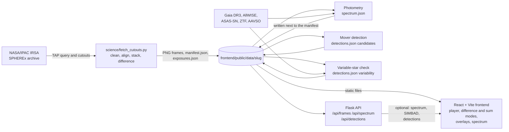
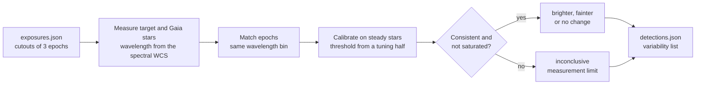

# SPHEREx Sky Time Machine

**Team Null Point · NASA Space Apps Cairo 2026 · Challenge: "Planet X and SPHEREx"**

Type a sky position (or pick a test target) and watch NASA SPHEREx infrared images of that spot play like a short video. Anything that moves or changes brightness stands out. Difference mode shows what changed; sum mode stacks every visit into a deeper image; clicking a point shows its spectrum.

We do not claim to find Planet X. It's the motivation: the tool gives anyone the means to look.

## Architecture

Everything starts from the NASA/IPAC archive. One pipeline turns SPHEREx exposures into baked frames; the science modules read the same files and write their results next to the manifest; the website and the API only serve those files, so the demo works even when the archive or the API is down.



## Repo layout

```
backend/     Flask API (app.py), cache wrapper (Redis or in-memory), mock payloads, tests
frontend/    React + Vite app: player, coordinate input, FoV, difference/sum, URL state
  public/data/<target>/   baked PNG frames + manifest.json + exposures.json (served statically)
science/     data pipeline: fetch_cutouts.py, targets.json, make_synthetic.py
             variable-star check: variability.py, variability_to_detections.py, rwaur_answer_key.py,
             fetch_asassn.py, fetch_ztf.py, gaia_utils.py
             tests/check_rwaur_deliverables.py (checks the variable-star outputs)
docs/        api.md (API contract), variable_star_detector.md (variable-star check: idea, diagrams, challenges, results, how to run)
```

## Quick start

```bash
# Python (3.11+)
python -m venv .venv && source .venv/bin/activate
pip install -r requirements.txt

# 1. Bake frames for a target (talks to NASA/IPAC IRSA; first run downloads ~1.75 GB per target at the default 0.5° field)
python science/fetch_cutouts.py --target wise0855
python science/fetch_cutouts.py --target wise0855 --max-exposures 40   # quick first test
python science/fetch_cutouts.py --all                                  # all five test targets
python science/fetch_cutouts.py --ra 133.795 --dec -7.245 --slug mypatch --size 0.5

# 2. API
cd backend && python app.py            # http://localhost:5000/api/health
python -m pytest -q                    # backend tests

# 3. Frontend
cd frontend && npm install && npm run dev   # http://localhost:5173

# 4. Variable-star check (optional; needs the baked frames and internet; run from the repo root)
python science/variability.py --ra 76.956 --dec 30.401 --slug rw-aur
python science/rwaur_answer_key.py
python science/tests/check_rwaur_deliverables.py
```

**Everything the public sees is real SPHEREx data.** For developers only, `python science/make_synthetic.py` writes fake SPHEREx-shaped cutouts so code can be smoke-tested offline; they play at `/?target=mock` (not linked anywhere in the app, labelled as synthetic). They are never used for accuracy numbers: detection and variability are trained and tested on real stars and real asteroids with catalogue labels.

**Viewer options:** colour maps (heat, viridis, inferno, Null Point blue; blue–red for difference mode), contrast, and a **3-colour infrared** view on "All" (blue 0.75–1.6, green 1.6–3.8, red 3.8–5 µm; cold brown dwarfs show red). Overlays: target ring, its path over time, RA/Dec grid, scale bar, and **Gaia DR3** (moved to each frame's date with proper motion) and **AllWISE** sources. Hover shows RA/Dec. Hatched areas = no data.

Catalogues come from `python science/fetch_catalogs.py --target <slug>` (run automatically after each online bake; writes `catalogs.json` next to the manifest).

Shareable views: `/?target=wise0855`, `/?ra=133.795&dec=-7.245&fov=0.2&det=6&mode=diff`, `/?ra=08h55m10.8s&dec=-07:14:42.5`. Add `&embed=1` for a bare player to embed elsewhere.

## Deploy

**Website (GitHub Pages, free):** repo Settings → Pages → Source: **GitHub Actions**. Every push to `main` then builds and publishes `https://<user>.github.io/SPHEREx-sky-time-machine/` (`.github/workflows/pages.yml`). It is static only: frames, overlays and the close-up work from the files in `public/data`; the spectrum and SIMBAD panels need the API and say so when it is missing.

**Website (Vercel, free, alternative):** vercel.com → Add New → Project → import this repo → Root Directory `frontend` (framework: Vite) → Deploy. It works on its own: with no API it reads the baked files in `public/data`.

**API (Render, free):** render.com → New → Blueprint → this repo (uses `render.yaml`). When it's live, add `VITE_API_BASE=https://<your-service>.onrender.com` in Vercel → Settings → Environment Variables and redeploy. Free Render services sleep after inactivity; the site keeps working from static files while it wakes.

New frames: run the pipeline, commit `frontend/public/data/`, push. The site redeploys automatically.

Pictures vs. science data: in the website pictures, overloaded star cores are drawn white and small isolated holes (≤ 40 px, pixels flagged in the only photo of that spot) are painted with their surroundings. `stacks.fits` keeps all of these blank, and every measurement uses `stacks.fits`.

## How the pipeline works (`science/fetch_cutouts.py`)

1. **Position.** Resolve the name with SIMBAD, then apply proper motion to the cutout epoch (`--epoch`, default 2026.0).
2. **Query.** IRSA TAP on `spherex.artifact JOIN spherex.plane`: every Spectral Image whose footprint contains the position, all detectors, all releases in the TAP tables (QR3 + DR1 as of Nov 2026; IRSA says they supersede QR2). Duplicates across releases are dropped.
3. **Cutouts.** IRSA cutout service (`?center=ra,decd&size=deg`), cached in `science/cache/<slug>/`, parallel downloads with retries.
4. **Clean.** `IMAGE − ZODI` (ZODI is not pre-subtracted). Bad pixels are masked **by flag name**, read from the `MSKNnnnn` cards in the FLAGS header. OVERFLOW, NONLINEAR and SOURCE are left unmasked on purpose: masking them would cut holes in bright stars (Barnard's Star). They're still counted in the flag summary.
5. **Align.** `reproject` every cutout onto one north-up TAN grid at 6.15″/px centred on the target.
6. **Stack.** Split exposures into survey passes by time gap, then do an inverse-variance mean per (pass, detector) and per pass over all six detectors.
7. **Difference.** Each pass minus the stack of all other passes, scaled ±5σ.
8. **Write.** PNGs, `manifest.json`, `exposures.json` → `frontend/public/data/<slug>/`; float stacks → `science/output/<slug>/stacks.fits`.

The same asinh stretch is used for every pass of a detector, so brightness changes between frames are real.

## How the variable-star check works (`science/variability.py`, `science/rwaur_answer_key.py`)

Status: **prototype** (3 epochs of RW Aur, small samples). Full notes, diagrams, challenges and results: `docs/variable_star_detector.md`.



1. **Stars.** Gaia DR3 cone search around the target (`gaia_utils.py` tries VizieR, the ESA Gaia archive and IRSA in turn). Known variables come from `phot_variable_flag`; steady stars are the rest.
2. **Measure.** Aperture photometry with a local sky annulus on every star in each SPHEREx cutout. Each star's wavelength comes from the spectral WCS, because SPHEREx uses a linear variable filter.
3. **Match.** A star is only compared with itself, in the same wavelength bin (passbands overlap by 50% or more), on different days. Time is the exposure MJD, not the header `DATE`.
4. **Calibrate.** The detection threshold is the 95th percentile of steady-star scatter on a tuning half; accuracy is reported on stars held back. Formal errors alone are never used (they gave chi-square 4794 in our first notebook).
5. **Be honest.** Epoch pairs whose repeated measurements disagree, or whose aperture is saturated, are reported as *inconclusive* (a measurement limit), not as a brightness change. RW Aur is near the saturation limit.
6. **Compare (optional).** `rwaur_answer_key.py --external <csv>` compares epoch-to-epoch direction with external monitoring. `fetch_asassn.py` and `fetch_ztf.py` write such a CSV to `data/` (git-ignored); use `--band g`, `--band r` or `--band V` to match the CSV.
7. **Write.** `science/output/<slug>/` (git-ignored) gets `variability_summary.json`, `variability_results.csv`, `rwaur_summary.json` and friends. `variability.py` (or, without downloads, `variability_to_detections.py --slug <slug>`) writes the `variability` list of `frontend/public/data/<slug>/detections.json` in the shape of `docs/api.md` and keeps any `candidates` already in the file.

Use the data folder name as the slug (`rw-aur`, not `rwaur`).

## Team workflow

- One branch per feature (`feat/player-controls`, `feat/photometry` …); someone else looks before merging to `main`.
- Raw cutouts (`science/cache/`) and float stacks (`science/output/`) are git-ignored. Baked PNGs + JSON under `frontend/public/data/` **are** committed, so the demo works without the archive.
- New science outputs plug into the API by dropping a file next to the manifest: `spectrum.json`, `detections.json` (see `docs/api.md`).

| Member | Owns |
| --- | --- |
| Ahmed Wael (lead) | Backend, pipeline, Redis, deployment, submission |
| Youssef Magdy | UI design and React frontend |
| Remon Nady | Moving-object detection on difference images |
| Fatma Amr | Variable-star flagging; models into the API |
| Alaa Ahmed | Photometry, spectra, light curves, charts |
| Anton Elia | Validation vs Gaia/WISE, injection tests |

## Data and credits

- SPHEREx data: NASA/IPAC Infrared Science Archive (IRSA). https://irsa.ipac.caltech.edu/Missions/spherex.html
- IRSA SPHEREx tutorials (query and cutout recipe): https://caltech-ipac.github.io/irsa-tutorials/
- SIMBAD (CDS Strasbourg) for name resolution and proper motions
- Gaia DR3 (ESA) for star lists and variability flags; external RW Aur monitoring from ASAS-SN Sky Patrol, ZTF (via IRSA) and AAVSO; literature context: AAVSO Observing Campaign #884 and Lisse et al. 2025 (RNAAS)
- Astropy, astroquery, reproject, photutils, NumPy, pandas, Matplotlib, Flask, React, Vite

**AI use disclosure:** Claude (Anthropic) helped with planning, the proposal text, the logo, the slides, the initial code scaffold (pipeline, API and player), and the variable-star check scripts. The team reviewed, tested and extended it.