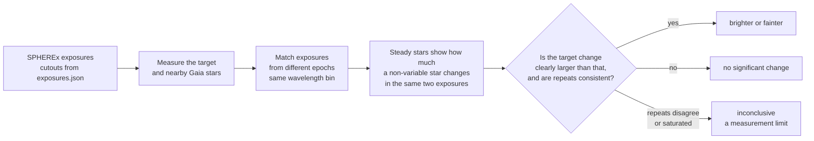
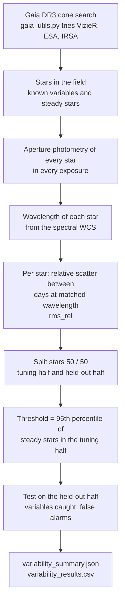
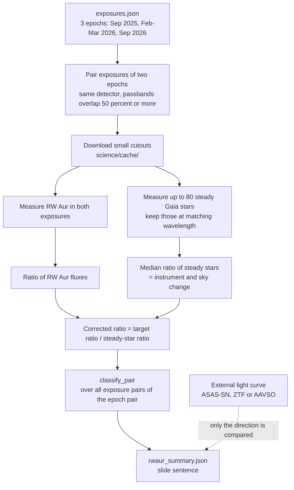
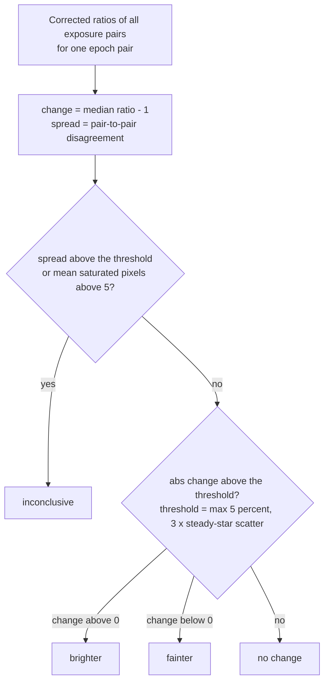
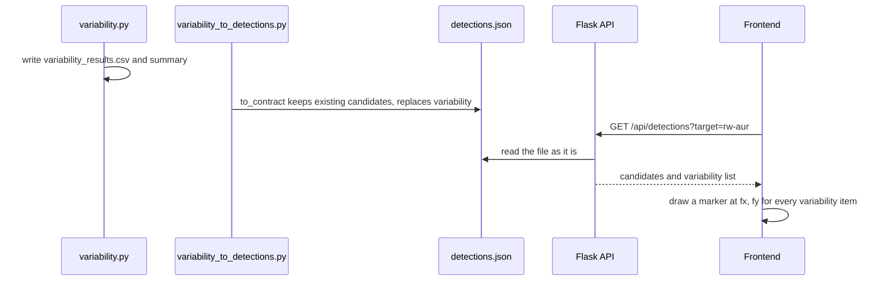

# Variable-star flagging and the RW Aurigae check

Owner: Fatma Amr.
Scripts: `science/variability.py`, `science/variability_to_detections.py`, `science/rwaur_answer_key.py`, `science/fetch_asassn.py`, `science/fetch_ztf.py`, `science/gaia_utils.py`.
Checker: `science/tests/check_rwaur_deliverables.py`.

Status: **prototype**. Real SPHEREx data only, 3 epochs of RW Aur, small test samples. Quote every number below with that caveat.

## 1. The idea in one picture

SPHEREx looks at the same sky position several times, but each exposure samples a different wavelength (the filter is a linear variable filter). So "the star got brighter" is only meaningful if both measurements are taken at the same wavelength, and only if we know how noisy that comparison normally is. We get the noise level from steady stars measured in the same exposures.



## 2. What makes this approach different

- **Self-calibrating.** Brightness is never compared across different wavelengths or against a model. A star is compared to itself, in the same wavelength bin, calibrated by steady stars in the same two exposures.
- **The threshold comes from steady stars, not from formal errors.** Our first notebook used only formal errors and produced chi-square = 4794 for 2 degrees of freedom. That is a calibration problem, not a discovery, so it is replaced by measured star-to-star scatter. The notebook numbers are not used anywhere.
- **A third answer: "inconclusive".** If repeated measurements at the same wavelength disagree by more than steady stars do, or the aperture is saturated, the result is a measurement limit, not a brightness change.
- **Real labels, held-out testing.** Labels come from Gaia DR3 (`phot_variable_flag`). Tuning and testing use different stars. No synthetic data is used for any accuracy number.
- **Reproducible.** One script per task, cutouts cached in `science/cache/`, outputs in `science/output/<slug>/`, and a checker that validates all deliverables.

## 3. How the two tasks work

### 3a. Variable-star flagging (`science/variability.py`)



### 3b. RW Aur epoch comparison (`science/rwaur_answer_key.py`)



### 3c. How an epoch pair is classified (`classify_pair`)



## 4. How it connects to the website and the API

The API serves `frontend/public/data/<slug>/detections.json` as it is. The file must follow `docs/api.md`: `variability` is a **list**, next to `candidates`.



Shape written for each flagged star inside the field:

```json
{"ra": 76.9607, "dec": 30.3174, "fx": 0.4918, "fy": 0.6673, "score": 1.0,
 "known_match": "Gaia DR3 156335744423799680 (catalogued variable)", "kind": "variable"}
```

- `fx`, `fy`: position as a fraction of the image, north up, east left (same convention as `predicted.fx/fy` in `manifest.json`).
- `score`: `rms_rel / (2 x threshold)`, capped at 1. A star exactly at the threshold has score 0.5.
- `known_match`: the Gaia identifier for catalogued variables, `null` for everything else.
- Only flagged stars inside the 0.5 degree field are written. The file also keeps a `variability_summary` object (not part of the contract) with the held-out numbers.
- Stars flagged here that Gaia calls steady are the false alarms of the test. Do not present them as discoveries.

## 5. Challenges and how we handled them

| # | Challenge | What we did |
|---|---|---|
| 1 | **The wavelength depends on where a source falls on the detector** (linear variable filter). Early measurements of the same star looked inconsistent because they sampled different wavelengths. | Only compare exposures whose passbands overlap by at least 50% (stars are binned in 2%-wide log-wavelength bins; epoch pairs are matched on the target wavelength). Wavelength comes from the spectral WCS (`key="W"`), per star. |
| 2 | **Wrong dates.** The FITS header `DATE` is not a reliable observation time. | Use the exposure time (`mjd`) from `exposures.json` / IRSA `t_min`. Epochs: Sep 2025, Feb-Mar 2026, Sep 2026. |
| 3 | **Formal errors are far too small.** They gave chi-square = 4794 (2 dof). | Calibrate on an ensemble of steady Gaia stars in the same two exposures. The detection threshold is the 95th percentile of steady-star scatter in the tuning half. |
| 4 | **Saturation.** RW Aur is bright; some aperture pixels are flagged OVERFLOW / NONLINEAR. | Following the pipeline policy those flags are not masked (masking would cut holes in bright stars) but they are counted. Pairs with high saturation, or large pair-to-pair disagreement, are `inconclusive`. |
| 5 | **Measurements disagree even at the same wavelength.** Within one epoch pair, nearly identical wavelengths gave ratios from 0.9 to 2.1, while steady stars repeat to about 2-6%. | Added the pair-to-pair spread test. 2 of 3 RW Aur epoch pairs fail it and are reported as a measurement limit. |
| 6 | **RW Aur is a close binary (about 1.5 arcsec); one SPHEREx pixel is 6.15 arcsec.** | Documented as a caveat. Both components are blended in every measurement. |
| 7 | **Few epochs.** Only 3, so epoch pairs are not independent. | Reported as "3 epochs, small sample". Pair 0 to 2 is a consistency check, not independent evidence. |
| 8 | **External data does not cover our dates.** The ASAS-SN light curve we could fetch ends in Feb 2025 (MJD 60693); our first epoch is Sep 2025 (MJD 60919). AAVSO delivers data by email. | The comparison code is ready (`--external <csv>`). `fetch_ztf.py` tries ZTF through IRSA. Until a CSV covers our epochs we only give literature context: AAVSO Observing Campaign #884 and Lisse et al. (2025) describe a major dimming of RW Aur starting in early 2025. No per-epoch bright/faint label is claimed. |
| 9 | **VizieR returned HTTP 404** while building the star list. | `gaia_utils.gaia_cone()` tries several Gaia sources in order (VizieR mirror, ESA Gaia archive, IRSA, VizieR CDS). In practice the ESA archive answered. |
| 10 | **Small variable sample.** Only a handful of Gaia-flagged variables fall in the field. | Report held-out numbers with the sample size and the label "tiny sample, prototype". A larger `--radius` can add stars. |
| 11 | **The file shape did not match the API contract.** The first `detections.json` had `variability` as an object and none of `ra`, `dec`, `source`, `candidates`; the API serves the file as it is, so the frontend would have received the wrong shape. | `to_contract()` writes the shape from `docs/api.md`, keeps other keys (for example mover `candidates`), and `variability_to_detections.py` rebuilds the file from saved results without any download. |
| 12 | **Engineering issues.** Pandas 3 returns read-only arrays (shuffle failed); the data folder is `rw-aur` but an early run used `rwaur`; astropy printed long SIP messages; full-image downloads were slow. | `.copy()` before shuffling; always run with `--slug rw-aur`; astropy log level set to WARNING (the SIP message is informational); cutouts cached in `science/cache/`. `science/cache/`, `science/output/` and `data/` are git-ignored. |

## 6. Results so far (prototype)

**RW Aur, SPHEREx only** (wavelength-matched, calibrated on steady stars):

| Epoch pair | Change | Pair-to-pair spread | Result |
|---|---|---|---|
| 0 to 1 (Sep 2025 to Feb/Mar 2026) | +5.2% (threshold 12.9%) | 3.3% | no significant change |
| 1 to 2 (Feb/Mar 2026 to Sep 2026) | -23.7% | 30.1% | inconclusive |
| 0 to 2 | +90.7% | 87.8% | inconclusive |

Slide sentence: *RW Aur is near SPHEREx's saturation limit: 2 of 3 epoch pairs gave inconsistent repeated measurements, so we report a measurement limit, not a brightness change. Reliable pair(s): epoch 0->1: no change (+5.2%, threshold 13%) (prototype, 3 epochs, not yet compared with external data).*

**Variable-star flagging, held-out Gaia-labelled stars in the RW Aur field:** 3 of 8 known variables caught, 3 false alarms among 20 steady stars. The false-alarm rate (15%) is above the 5% design target because the tuning sample is small. 2 flagged stars fall inside the 0.5 degree field and are written to `detections.json`.

**Not yet done:** agreement with external monitoring ("X of Y epoch pairs"). It needs an external light curve covering Sep 2025 to Sep 2026.

## 7. How to run it

From the repository root, with `.venv` active:

```bash
pip install -r requirements.txt

# 1. Variable-star flagging (writes variability_*.json/csv and detections.json)
python science/variability.py --ra 76.956 --dec 30.401 --slug rw-aur --radius 0.4 --max-obs 15

# 1b. Rebuild only detections.json from saved results (fast, no downloads)
python science/variability_to_detections.py --slug rw-aur

# 2. RW Aur epoch comparison (SPHEREx side only)
python science/rwaur_answer_key.py

# 3. Optional: external light curve, then compare
pip install skypatrol
python science/fetch_asassn.py                                   # data/rwaur_external.csv (ends Feb 2025)
python science/fetch_ztf.py                                      # data/rwaur_ztf.csv
python science/rwaur_answer_key.py --external data/rwaur_ztf.csv --band r
#   (AAVSO CSV: use --band V; ASAS-SN CSV: --band g)

# 4. Check all deliverables
python science/tests/check_rwaur_deliverables.py
```

Outputs in `science/output/rw-aur/` (git-ignored):

| File | Content |
|---|---|
| `variable_truth.csv` | answer key: Gaia stars labelled variable / steady |
| `variability_results.csv` | per star: relative scatter, flag, tune/held-out split |
| `variability_summary.json` | threshold, variables caught, false alarms |
| `rwaur_answer_key.csv` | per epoch: external magnitude and bright/faint label (when external data exists) |
| `rwaur_pair_results.csv` | every exposure pair measured |
| `rwaur_summary.json` | epoch-pair comparison and the slide sentence |

## 8. Known limits and next steps

- 3 epochs and a small sample of known variables: numbers are prototype-level.
- `variability.py` still downloads full SPHEREx images through IRSA. Reading the small cutouts listed in `exposures.json` (as `rwaur_answer_key.py` does) would make it much faster.
- External comparison needs a light curve covering our epochs (ZTF through IRSA, or AAVSO data by email).
- The steady-star list is "not flagged variable by Gaia". Some of those stars are probably low-level variables. That inflates the steady-star scatter, so the threshold ends up higher and the detector less sensitive. Cross-matching with VSX would give a cleaner list.
- Optical external bands (V, g, r) vs 0.75-5 um SPHEREx: only the direction of change can be compared, never the amplitude.
- Only `rw-aur` has a `variability` list today; the other targets do not.